## システム構成図

```mermaid
flowchart TB
    subgraph external["外部サービス"]
        qiita["Qiita（RSS）"]
        zenn["Zenn（RSS）"]
        hatena["はてなブックマーク（RSS）"]
        supabase["Supabase（Auth）"]
        discord["Discord Webhook"]
    end

    subgraph cloudflare["Cloudflare"]
        subgraph private["private"]
            cron["Cron<br/>Workers Scheduled"]
        end
        subgraph public["public"]
            web["Web<br/>Hono + React Router"]
        end
        d1[("D1<br/>SQLite + Drizzle ORM")]
    end

    user["利用者"]
    dev["開発者"]
    gha["GitHub Actions"]

    qiita -->|RSS取得| cron
    zenn -->|RSS取得| cron
    hatena -->|RSS取得| cron
    cron -->|記事保存| d1
    cron -->|通知| discord

    user -->|閲覧| web
    web -->|記事取得| d1
    web -->|認証| supabase

    dev -->|push| gha
    gha -->|デプロイ| web
    gha -->|デプロイ| cron
```

## システム構成

- **Web**: Hono + React Router（Cloudflare Workers）
- **Cron**: RSS取得（Cloudflare Workers Scheduled）。Qiita / Zenn / はてなブックマークのフィードを取得する
- **Database**: Cloudflare D1（SQLite互換）+ Drizzle ORM
- **Auth**: Supabase
- **Notification**: Discord Webhook

## Workers のオブザーバビリティ

Web / Cron の両 Worker で、Workers Logs（全 invocation）、Traces（5%）、Issues とソースマップを利用します。Web は SSR ビルドだけソースマップを生成し、公開するクライアントアセットには含めません。

- Workers Free のログはアカウント全体で 1 日 200,000 イベント、保持期間 3 日です。ログのサンプリング率は invocation の割合であり、ログ件数そのものの上限ではありません。
- Issues はオープンベータ期間中、全 Workers アカウントで無料です。有効化後の新しい失敗が対象です。
- Traces は保持期間 7 日です。2026-12-01 からログ・トレースの料金体系が変わる予定のため、その前に無料枠と利用量を再確認してください。
- デプロイ後は Cloudflare の各 Worker の Observability でログ・トレース・Issues を確認します。ソースマップは捕捉された例外スタックの解決に使われ、アプリ内で出力した `error.stack` 自体は変換されません。

参照: [Workers Logs](https://developers.cloudflare.com/workers/observability/logs/workers-logs/)、[Traces](https://developers.cloudflare.com/workers/observability/traces/)、[Issues](https://developers.cloudflare.com/workers/observability/issues/)、[Source maps](https://developers.cloudflare.com/workers/observability/source-maps/)
